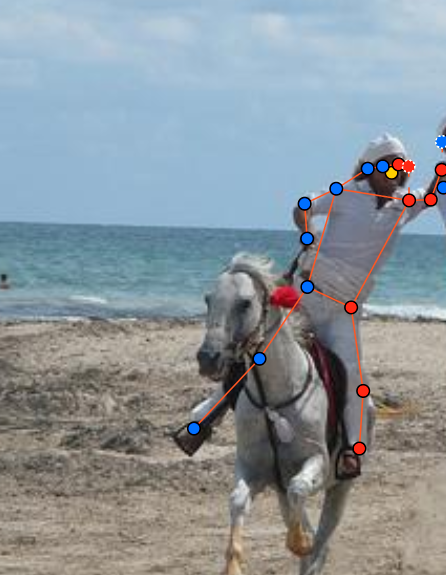
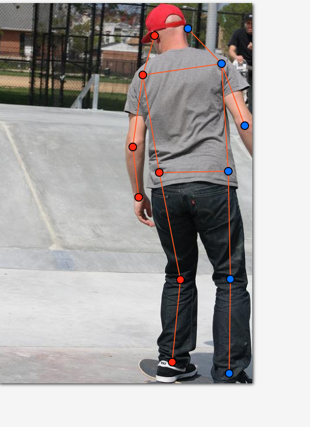
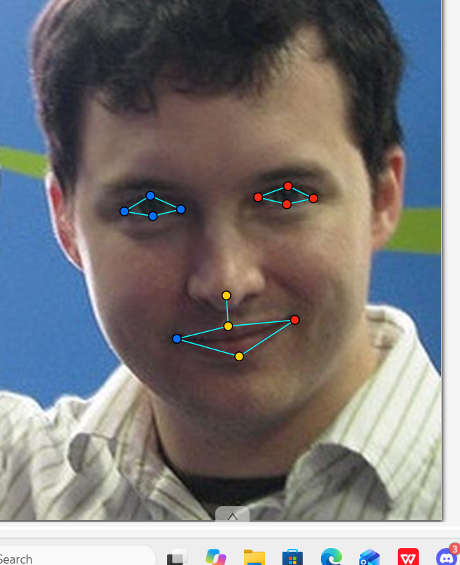

# Báo cáo cá nhân — BuiSyTung-2A202603323

Đổi tên file theo quy tắc `MSSV_HoTen.md`. Ví dụ: `20241234_NguyenVanAn.md`.

Dữ liệu: 12 ảnh người COCO val2017 (Lin et al., 2014) và 8 ảnh chân dung Wikimedia Commons, chỉ dùng trong lớp.

## 0. Thông tin học viên

- Họ tên: Bùi Sỹ Tùng
- MSSV: 2A202603323
- Email: buisytungk25cntt@gmail.com
- Link repository: https://github.com/BuffDarkAI
- Phiên bản CVAT (Help → About): 2.82.1
- Máy: hệ điều hành Windows 11 · RAM 16 GB · chạy CVAT chế độ đầy đủ
- Bộ ảnh (`src/exports/assignment.json` do `lab.py setup` tạo): có
- Giờ bắt đầu: 17:00 (12/11/2026)
- Giờ kết thúc: 11:00 (13/11/2026)

## 1. Kiểm tra label (CP0)

| Label | Kiểu | Số điểm | Tên điểm đúng bảng của lab? | Đúng thứ tự? | Số cạnh |
|---|---|---:|---|---|---:|
| `person` | Skeleton | 17 | Có | Đúng | 19 |
| `face` | Skeleton | 13 | Có | Đúng | 13 |

Mẫu `person` dựng theo người quay mặt về camera (các điểm `left_*` nằm bên phải khung mẫu)? Có

Cách đổi cờ `occluded` / `outside` cho **một điểm** trên phiên bản CVAT này (một câu):
Rê chuột vào đúng điểm cần đổi cho điểm sáng lên, bấm phím Q để đổi thành `occluded` (v = 1) hoặc phím O để đổi thành `outside` (v = 0), hoặc bấm chuột phải vào điểm để chọn trạng thái trong menu ngữ cảnh.

## 2. Số lượng đã gán và thời gian (CP1, CP2)

| Nhóm ảnh | Số ảnh | Số skeleton đã gán | Số người dưới 60 px (không gán) | Số poster / gương / màn hình bỏ qua | Thời gian (phút) |
|---|---:|---:|---:|---:|---:|
| `easy` | 5 | 5 | 0 | 0 | 25 |
| `occluded` | 3 | 6 | 0 | 0 | 30 |
| `back` | 2 | 2 | 0 | 0 | 20 |
| `small` | 1 | 2 | 1 | 0 | 15 |
| `crowd` | 1 | 2 | 3 | 0 | 25 |
| `faces` | 8 | 8 | — | 0 | 25 |

- Số ảnh người đã xong ở mốc phút 105: 10 / 10
- Thời gian thực tế (phút): CP1 115 · CP2 25 · CP3 20
- Ảnh tốn thời gian nhất là ảnh nào, vì sao?
Ảnh `000000461389.jpg` (nhóm occluded có 3 người) và `000000130816.jpg` (nhóm crowd đông người) tốn thời gian nhất vì có nhiều người đứng đan xen, nhiều khớp bị che khuất bởi người khác hoặc vật thể xung quanh, đòi hỏi phải phóng to tối đa để xác định đúng tâm khớp và cân nhắc cẩn thận cờ `occluded` (v = 1) hay `outside` (v = 0).

## 3. Bảng ca khó (CP1, CP2)

Mỗi điểm bạn phân vân một dòng, nhất là phân vân giữa `v = 1` và `v = 0`, hoặc không chắc hướng người.

| Ảnh | Người / mặt | Điểm | Cờ đã chọn | Phân vân giữa | Lý do chọn |
|---|---|---|---:|---|---|
| `000000359340.jpg` | Người 1 (quay lưng) | `nose`, `left_eye`, `right_eye` | 0 | `v = 0` và `v = 1` | Người quay lưng hoàn toàn về phía camera, khuôn mặt bị che khuất 100% không thể quan sát hay suy đoán vị trí chính xác nên chọn `outside` (`v = 0`). |
| `000000515309.jpg` | Người 1 (quay lưng) | `nose`, `left_eye`, `right_eye` | 0 | `v = 0` và `v = 1` | Mặt người bị quay góc khuất, không đoán bừa điểm mặt nên đặt `outside` (`v = 0`); trong khi tai nhìn thấy viền và hướng đầu nên chọn `v = 1`. |
| `000000461389.jpg` | Người 2 (bị che) | `left_shoulder`, `left_elbow`, `left_wrist` | 0 | `v = 0` và `v = 1` | Cánh tay và vai trái bị người đứng trước che khuất hoàn toàn, không có cơ sở hình học để ước lượng chắc chắn nên chọn `outside` (`v = 0`). |
| `000000188804.jpg` | Người 1 | `right_hip`, `right_ankle` | 1 | `v = 1` và `v = 2` | Chân phải bị khuất một phần sau trang phục và bóng đổ, nhưng dựa vào hướng đùi và đầu gối vẫn ước lượng chắc chắn được vị trí khớp xương nên chọn `occluded` (`v = 1`). |
| `000000130816.jpg` | Người 2 (đám đông) | `left_hip`, `right_hip`, `left_knee`, `right_knee` | 0 | `v = 0` và `v = 1` | Nửa thân dưới của người bị vật cản phía trước che hoàn toàn, chỉ thấy từ ngực trở lên nên nửa dưới chọn `outside` (`v = 0`). |
| `face_294580.jpg` | Mặt 1 | 8 điểm mắt (`left_eye_*`, `right_eye_*`) | 1 | `v = 1` và `v = 2` | Người đeo kính râm tối màu che khuất mí mắt và con ngươi, nhưng nhìn rõ gọng kính nên đặt tọa độ mắt theo gọng kính và gán cờ `occluded` (`v = 1`). |
| `face_559185.jpg` | Mặt 1 | `left_eye_upper`, `right_eye_upper` | 1 | `v = 1` và `v = 2` | Tóc mái rủ xuống che một phần viền mí trên, ước lượng được nhờ con ngươi và mí dưới nên chọn `occluded` (`v = 1`). |

## 4. Bảng tự review (CP3)

Đi từ ảnh cuối về ảnh đầu. 5 ảnh người (ít nhất 2 ảnh `back` hoặc `crowd`) và 3 ảnh mặt. Ít nhất 8 dòng, kể cả dòng `ok`. Ghi lỗi trước, sửa sau.

Mã lỗi dùng đúng một trong: `lr_swap`, `vis_flag`, `position`, `missing`, `extra`, `ok`.

| Ảnh | Người / mặt | Điểm | Mã lỗi | Ghi chú | Đã sửa? |
|---|---|---|---|---|---|
| `000000515309.jpg` | Người 1 (nhóm `back`) | Toàn thân | `lr_swap` | Người quay lưng, ban đầu kéo khung mẫu điểm left/right theo mắt nhìn camera, đã đảo các điểm `left_*` sang bên trái ảnh và `right_*` sang bên phải ảnh | Có |
| `000000461389.jpg` | Người 2 (nhóm `occluded`) | Vai và cánh tay | `vis_flag` | Ban đầu để mặc định `v = 2` dù bị người phía trước che, đã sửa lại thành `outside` (`v = 0`) | Có |
| `000000359340.jpg` | Người 1 (nhóm `back`) | Mũi, mắt | `vis_flag` | Mặt người quay lưng không thấy nhưng chưa đổi cờ, đã sửa sang `outside` (`v = 0`) | Có |
| `000000188804.jpg` | Người 1 (nhóm `occluded`) | Hông phải (`right_hip`) | `position` | Điểm đặt bị lệch lên cạp quần thay vì vào tâm khớp chỏm xương đùi, đã kéo lại đúng khớp | Có |
| `000000130816.jpg` | Nhóm `crowd` | Toàn cảnh | `ok` | Đã kiểm tra đủ 2 người cao từ 60 px, các người nhỏ < 60 px ở xa bỏ qua đúng quy định | Có |
| `face_559185.jpg` | Mặt 1 (nhóm `toc`) | Mí trên 2 mắt | `vis_flag` | Tóc mái che mí trên nhưng để `v = 2`, đã chuyển thành `occluded` (`v = 1`) | Có |
| `face_294580.jpg` | Mặt 1 (nhóm `kinh_ram`) | 8 điểm mắt | `vis_flag` | Kính râm che mắt để `v = 2`, đã chuyển toàn bộ 8 điểm mắt thành `occluded` (`v = 1`) theo đúng guideline | Có |
| `face_125051.jpg` | Mặt 1 (nhóm `thang`) | 13 điểm | `ok` | Mặt thẳng rõ ràng, tỉ lệ khóe mắt và mí mắt đặt chuẩn xác, không có lỗi | Có |

Tổng hợp số lỗi theo mã:

| `lr_swap` | `vis_flag` | `position` | `missing` | `extra` | `ok` |
|---:|---:|---:|---:|---:|---:|
| 1 | 4 | 1 | 0 | 0 | 2 |

Điểm còn phân vân giữa `v = 1` và `v = 0` (ghi cả hai lựa chọn và lý do chọn):
Tại ảnh `000000130816.jpg` (người thứ 2 trong nhóm crowd), cổ tay trái (`left_wrist`) bị che khuất một phần. Lựa chọn 1: `v = 1` vì dựa vào hướng cẳng tay kéo dài có thể ước lượng khá chắc chắn vị trí cổ tay. Lựa chọn 2: `v = 0` vì mép vật cản che qua khu vực khớp. Quyết định chọn `v = 1` vì chi trên còn nhìn thấy rõ phương hướng chuyển động.

## 5. Kiểm file xuất và kết quả tự kiểm (CP4)

Tự kiểm tay trong file JSON:

| File | Người / mặt kiểm (ảnh, thứ tự) | Số phần tử `keypoints` | Điểm `outside` ra `v = 0`, `occluded` ra `v = 1`? | `num_keypoints` khớp? |
|---|---|---:|---|---|
| `BuiSyTung2b_persons.zip` | `000000007281.jpg`, người 1 | 51 | Đúng (`v = 1` cho tai) | Đúng (15) |
| `BuiSyTung2b_persons.zip` | `000000359340.jpg`, người 1 (quay lưng) | 51 | Đúng (`v = 0` cho mắt/mũi) | Đúng (13) |
| `BuiSyTung2b_faces.zip` | `face_294580.jpg`, mặt 1 (kính râm) | 39 | Đúng (`v = 1` cho 8 điểm mắt) | Đúng (13) |

Sau khi xuất, CVAT ghi `occluded` thành `v = 1` và `outside` thành `v = 0`. Tọa độ của điểm `outside` trong file là `0, 0` hay tọa độ cũ? Tọa độ cũ

Hai job đã chuyển sang completed trên CVAT? Có

Dán phần **TÓM TẮT** in ra từ `src/check_submission.py`:

```text
- File person: BuiSyTung2b_persons.zip
  Số ảnh: 12 · số skeleton `person`: 17 · mỗi annotation 51 số
  Skeleton theo ảnh: 000000007281=2, 000000130816=2, 000000188804=2, 000000225138=1, 000000308257=1, 000000343057=1, 000000359340=1, 000000433787=1, 000000461389=3, 000000515309=1, 000000516902=1, 000000525227=1
  Cờ v: v=2 228 (79%) · v=1 23 (8%) · v=0 38 (13%)
  num_keypoints trung bình: 14.8
- File face: BuiSyTung2b_faces.zip
  Số ảnh: 8 · số skeleton `face`: 8 · mỗi annotation 39 số
  Skeleton theo ảnh: face_125051=1, face_145621=1, face_294580=1, face_300399=1, face_380754=1, face_416730=1, face_490361=1, face_559185=1
  Cờ v: v=2 94 (90%) · v=1 10 (10%) · v=0 0 (0%)
  num_keypoints trung bình: 13.0
- Ghi chú: 38 điểm v = 0 vẫn mang tọa độ cũ (CVAT 2.x xuất như vậy; chuẩn COCO ghi 0, 0). Không phải lỗi: điểm v = 0 bị bỏ qua khi huấn luyện và khi chấm.
- Số [LỖI]: 0 · số [CẢNH BÁO]: 3
Kết quả: ĐẠT (đọc lại từng cảnh báo ở trên)
```

Các `[CẢNH BÁO]` còn giữ nguyên và lý do:
1. `000000225138.jpg #1`, `000000308257.jpg #1`, `000000343057.jpg #1`: Cảnh báo về cặp `knee` / `ankle` nằm ngược phía so với các cặp còn lại. Đã kiểm tra lại trên ảnh gốc: người trong các ảnh này có tư thế chân bắt chéo hoặc bước chéo chân thật khi vận động. Các điểm `left_*` và `right_*` đã được xác định chính xác theo hướng giải phẫu của người trong ảnh, không phải lỗi đổi trái/phải (`lr_swap`).
2. Ghi chú 38 điểm `outside` (`v = 0`) vẫn mang tọa độ cũ: Đây là cơ chế xuất mặc định của CVAT 2.x; các điểm `v = 0` không bị tính vào loss hay OKS nên hoàn toàn hợp lệ.

## 6. Ảnh chụp màn hình

1. Label `person` trong label constructor (đủ 17 điểm có tên):

   

2. Một người quay lưng đã gán, cờ đã đặt:

   

3. Một khuôn mặt đã gán 13 điểm, phóng to vùng mắt:

   

4. Xuất dataset định dạng COCO Keypoints 1.0 thành công (hoặc đoạn JSON xuất):

   


## 7. Tự đánh giá

1. Lỗi bạn mắc nhiều nhất hôm nay, và cách bạn sẽ tránh ở dự án thật:
Lỗi dễ mắc nhất là nhầm lẫn trái/phải (`lr_swap`) ở người quay lưng và người nhìn nghiêng, cùng với việc quên đổi cờ `occluded` (`v = 1`) cho các khớp bị che khuất. Ở dự án thật, em sẽ luôn tuân thủ nguyên tắc nói to hướng nhìn của đối tượng trước khi kéo khung mẫu, đảo vị trí các cặp điểm trái/phải trước khi tinh chỉnh chi tiết, và dùng phím tắt Q/O linh hoạt sau khi định vị từng khớp.

2. Một quy tắc bạn đề xuất thêm vào guideline (kèm ảnh ví dụ nếu có):
Đề xuất bổ sung hướng dẫn rõ ràng hơn về độ mờ chuyển động (motion blur) hoặc thiếu sáng: khi một chi bị nhòe chuyển động mạnh, nếu tâm khớp còn có thể nội suy dựa vào chiều dài xương thì nên quy ước đặt `v = 1` thay vì để `v = 2` hoặc bỏ sang `v = 0`.

3. Nhãn của bạn đi vào model ở đâu? Chọn một lỗi bạn đã sửa và nói nó sẽ làm model học sai thế nào (heatmap, trọng số trong loss, hay bước lật ảnh):
Lỗi `lr_swap` (đảo trái/phải): Model pose estimation tạo heatmap riêng cho từng kênh khớp (ví dụ kênh `left_wrist` và `right_wrist` là 2 kênh độc lập). Nếu ta gán nhầm tay trái thành tay phải cho người quay lưng, model sẽ bị phạt loss nặng nề khi huấn luyện. Nghiêm trọng hơn, trong khâu data augmentation (lật ngang ảnh - horizontal flip), cặp điểm `left_*` và `right_*` sẽ bị hoán đổi tên tự động, khiến nhãn sai bị nhân đôi độ lệch, làm hỏng khả năng phân biệt đối xứng của mạng nơ-ron.

## 8. Khó khăn và lỗi kỹ thuật
Gặp một số khó khăn ban đầu khi xuất file dataset từ CVAT do chọn nhầm định dạng xuất (YOLO/CVAT XML thay vì COCO Keypoints 1.0) và quên tắt tùy chọn "Save images". Sau khi đọc lại hướng dẫn và chạy lệnh `python lab.py export`, dữ liệu đã được xuất đúng chuẩn COCO Keypoints 1.0 và vượt qua toàn bộ các bài kiểm tra tự động của script `check_submission.py`.

## Bonus (nếu làm)
(Không làm bonus)

## 9. Tài liệu tham khảo và công cụ AI đã dùng
- Tài liệu hướng dẫn thực hành Lab 04: GUIDELINE.md, CVAT_CHEATSHEET.md, COCO_KEYPOINTS.md.
- Công cụ AI (Google DeepMind Antigravity): Sử dụng để tra cứu quy chế, giải thích nguyên lý OKS, hướng dẫn phím tắt CVAT và giải thích các cảnh báo từ script `check_submission.py`.
